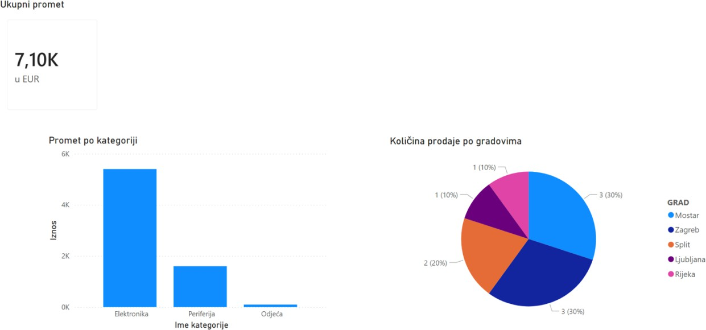
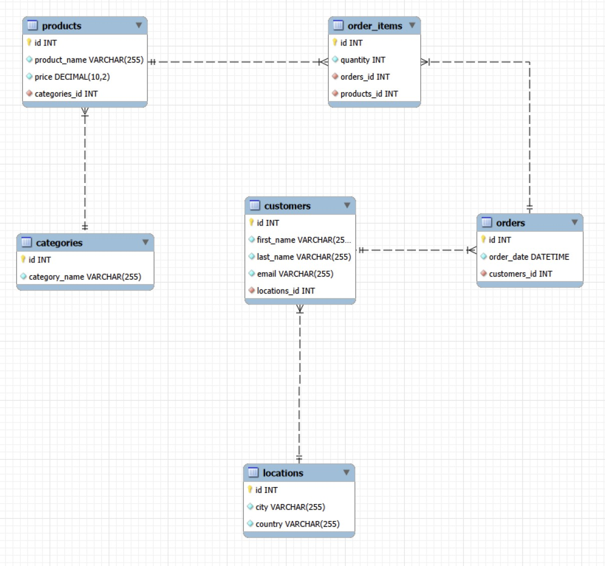
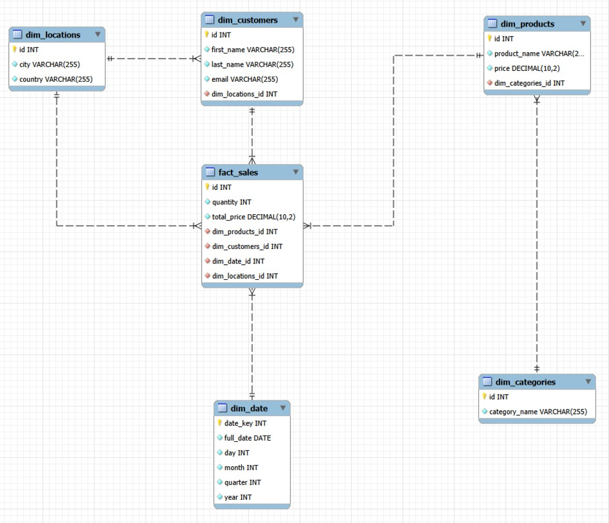

# E-commerce Data Warehouse

An end-to-end business intelligence system for a webshop: transactions are recorded
in a normalized MySQL OLTP database, loaded via SQL ETL into a snowflake-schema data
warehouse (OLAP) and visualised in Power BI. Built as my bachelor thesis at
Zagreb University of Applied Sciences (TVZ).

## Architecture

MySQL OLTP (ecommerce_oltp) → SQL ETL → Snowflake DWH (ecommerce_olap) → Power BI

OLTP and OLAP are separated because they serve different purposes. The OLTP database
records day-to-day transactions, such as a product being sold, and is normalized for
fast, reliable writes. The OLAP data warehouse is structured for analytical queries
like *"How many phones were sold in Q1 in Rijeka?"*. Running such queries, with
many joins and aggregations, directly on the OLTP database would slow down the webshop.

## Data model

### Source (OLTP)

The source database `ecommerce_oltp` has six normalized tables: `customers`, `locations`,
`products`, `categories`, `orders` and `order_items`. Each fact is stored once, which
keeps writes fast and data consistent.

### Data warehouse (OLAP, snowflake schema)

The data warehouse `ecommerce_olap` has a central fact table `fact_sales` and five
dimension tables: `dim_customers`, `dim_products`, `dim_date`, `dim_locations` and
`dim_categories`.

**Grain:** one row in `fact_sales` represents one order line (one product in one order).

**Why snowflake:** product categories and customer locations are kept in separate
dimension tables (`dim_products → dim_categories`, `dim_customers → dim_locations`),
mirroring the source structure and avoiding repeated category and city names.
The trade-off is one extra join per query compared to a star schema. For larger
models, a star schema is usually preferred, especially in Power BI.

`fact_sales` also stores `dim_locations_id` directly (the customer's location at load
time), so sales by city can be queried without joining through `dim_customers`.
## ETL

The ETL is a single SQL script (`sql/03_etl_oltp_to_olap.sql`) that loads the data
warehouse from the source database in four steps. The load order respects
foreign keys: a table is filled only after the tables it references.

1. **Independent dimensions:** `dim_categories` and `dim_locations` are copied 1:1
   from the source.
2. **Dependent dimensions:** `dim_customers` and `dim_products`, which reference
   the dimensions above.
3. **Date dimension:** `dim_date` is derived from order dates. Each date gets an
   integer key in `YYYYMMDD` format (e.g. `20260115`) and is split into
   day, month, quarter and year, so Power BI needs no date calculations.
4. **Fact table:** `fact_sales` joins `order_items`, `orders`, `products` and
   `customers`. `total_price` does not exist in the source; it is calculated
   as `quantity × price` during the load.

The script ends with a check query: total revenue in `fact_sales` must equal
**7,100.00 €**, the sum of all source transactions.

## How to run

**Requirements:** MySQL 8.0 or newer and a SQL client (e.g. MySQL Workbench).

Run the scripts in this order:

| Step | Script | What it does |
| --- | --- | --- |
| 1 | `sql/01_oltp_schema_and_data.sql` | Creates `ecommerce_oltp` and loads the test data |
| 2 | `sql/02_olap_schema.sql` | Creates the empty `ecommerce_olap` data warehouse |
| 3 | `sql/03_etl_oltp_to_olap.sql` | Loads the warehouse from the source database |

**Expected result:** the check query at the end of step 3 returns
`total_revenue = 7100.00`.

Scripts 01 and 02 drop and recreate their tables, so the whole pipeline can be
re-run from step 1 at any time. Script 03 alone is not re-runnable (see below).

The Power BI report (`powerbi/`) connects to `ecommerce_olap` on `localhost:3306`
in Import mode.

## Key insights

- **Electronics drives the business:** 5,400 € of the 7,100 € total revenue (~76%)
  comes from one of three categories. Clothing contributes only 100 €.
- **Zagreb and Mostar are the strongest markets:** together they account for 60% of
  units sold. Rijeka and Ljubljana account for 10% each.
- **Units sold ≠ revenue:** one TV (1,500 €) brings more revenue than many T-shirts,
  so both metrics need to be read together.

## Known limitations & next steps

- **Small test dataset:** 5 customers, 4 products and 8 orders, entered manually for
  the thesis. Next step: a Python data generator for a realistic volume
  (thousands of orders across two years, with seasonality).
- **Price taken at load time:** `total_price` uses the current price from `products`,
  not the price at the time of the order. A price change would rewrite historical
  revenue. Fix: store `unit_price` in `order_items`.
- **ETL is not idempotent:** running script 03 twice fails on duplicate dimension
  keys. Fix: truncate the warehouse before loading, or switch to incremental loads.
- **Naming:** `fact_sales.dim_date_id` references `dim_date.date_key`. The mismatch
  meant Power BI did not detect the relationship automatically; consistent key
  naming would avoid this.
- **Personal data in the warehouse:** `dim_customers` stores names and emails.
  Analytics does not need them, so a production version should pseudonymize them
  (GDPR data minimisation).

## Tech stack

MySQL · MySQL Workbench · SQL · Power BI